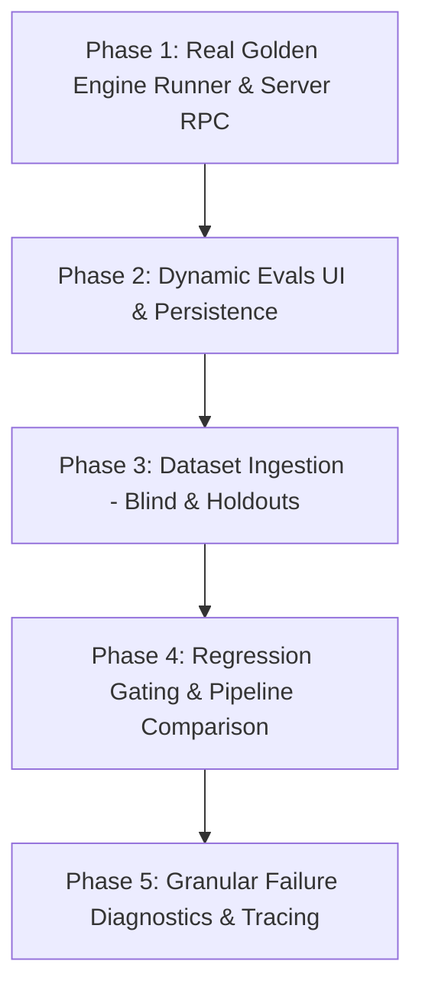

# Verity — Evals Implementation Roadmap

**Document:** `docs/IMPLEMENTATION_ROADMAP.md`  
**Purpose:** Phased delivery plan for transforming Verity Evals from static mock fixtures to a production-grade, reproducible evaluation harness.

---

## 1. Phased Implementation Plan

### Phase 1: Real Golden Suite Runner & Server RPC (Estimated: 2–3 hours)
- **Goal:** Expose the real Verity engine and golden evaluation suite through a typed server function.
- **Dependencies:** None. Can be implemented immediately using existing code.
- **Components:**
  - Create `src/verity-engine/evalRunner.ts`: Exposes `runSuite(suiteName)` using `golden_set.json` and `engine.serve()`.
  - Create `src/services/evals.functions.ts`: Server function `runEvalsFn` to execute suites server-side.
- **Acceptance Criteria:**
  - Running `runEvalsFn({ suite: 'golden' })` executes all 27 golden cases against the live Verity engine.
  - Returns actual 26/27 pass rate, detects `G17` failure, and calculates metrics dynamically without mocking.

### Phase 2: Dynamic Evals UI & Persistence (Estimated: 3–4 hours)
- **Goal:** Replace static mock constants in `/evals` with live execution controls and local report persistence.
- **Dependencies:** Phase 1 server functions.
- **Components:**
  - Update [src/routes/evals.tsx](file:///c:/Users/lakha/nitin_sir_collab/pixel-perfect-capture/src/routes/evals.tsx): Add "Execute Evaluation" button, suite selection, loading states, and dynamic chart/card rendering.
  - Create local filesystem storage (`src/verity-engine/data/eval_runs/<run_id>.json`) and a `getLatestEvalRun` endpoint.
- **Acceptance Criteria:**
  - Clicking "Execute Evaluation" triggers the real evaluation run.
  - Metric cards and Recharts bar chart render dynamic numbers computed from the execution.
  - Refreshing the browser preserves the latest completed run results.

### Phase 3: Dataset Ingestion — Blind & Holdout Sets (Estimated: 3–4 hours)
- **Goal:** Author and integrate genuine datasets for Blind set (30 cases), Hold-out set 1 (15 cases), and AEP hold-out (30 cases).
- **Dependencies:** Phase 1 runner.
- **Components:**
  - Create `src/verity-engine/data/blind_set.json`.
  - Create `src/verity-engine/data/holdout_set_1.json`.
  - Create `src/verity-engine/data/aep_holdout.json`.
- **Acceptance Criteria:**
  - Selecting "Blind set" or "Holdout" runs the respective test suite through the real engine.
  - If a dataset is absent or empty, the UI clearly displays "Dataset unavailable" rather than inventing fake percentages.

### Phase 4: Regression Gating & Pipeline Comparison (Estimated: 3–4 hours)
- **Goal:** Connect evaluation runs to authoring changes and provide candidate vs baseline comparison.
- **Dependencies:** Phase 1 & 2.
- **Components:**
  - Integrate `checkPublication()` in authoring review cards with evaluation history.
  - Add comparison view: Run baseline engine against candidate engine (e.g. modified units or prompt changes) and flag new regressions.
- **Acceptance Criteria:**
  - Highlights newly failing cases vs pre-existing failures.
  - Hard-blocks promotion when a critical regression is detected.

### Phase 5: Deep Failure Diagnostics & Reproducibility Traces (Estimated: 2–3 hours)
- **Goal:** Provide actionable debugging tools for failing evaluation cases directly in the UI.
- **Dependencies:** Phase 2.
- **Components:**
  - Expand Failure Log table in [src/routes/evals.tsx](file:///c:/Users/lakha/nitin_sir_collab/pixel-perfect-capture/src/routes/evals.tsx) to allow clicking a case row to inspect:
    - Expected vs actual outcomes and unit IDs.
    - 13-step pipeline execution trace (`TraceStep[]`).
    - Redacted query and extracted lexicon tokens.
- **Acceptance Criteria:**
  - For `G17`, clicking the row reveals that Part 1 failed because `"is shipping free"` lacked the subject `"mail order"` and missed the 0.5 coverage threshold.

---

## 2. Dependencies & Parallelization Matrix

| Task / Component | Blocked By | Can Run in Parallel With | Complexity |
|---|---|---|---|
| **Task 1: Evaluation Engine RPC** | None | UI Wireframing | Low (1–2 days) |
| **Task 2: Persistent Eval Run Store** | Task 1 | Dataset Authoring | Low (1 day) |
| **Task 3: Dynamic Evals UI Connection** | Task 1 & 2 | Dataset Authoring | Medium (2 days) |
| **Task 4: Blind & Holdout Dataset Creation** | None | Task 1, 2, 3 | Medium (2 days) |
| **Task 5: Per-Case Diagnostic Drawer** | Task 3 | Task 4 | Medium (2 days) |
| **Task 6: Automated CI Regression Runner** | Task 1 | Task 2, 3, 4 | Low (1 day) |

---

## 3. Prioritized Implementation Backlog (First Tasks)

### Task 1: Create `src/verity-engine/evalRunner.ts`
- **Objective:** Pure server-side runner that reads a dataset (e.g. `golden_set.json`), loops through cases, calls `engine.serve()`, evaluates `passes()`, and returns aggregated metrics.
- **Files to create/modify:**
  - New: `src/verity-engine/evalRunner.ts`
  - Reused: [src/verity-engine/regression.ts](file:///c:/Users/lakha/nitin_sir_collab/pixel-perfect-capture/src/verity-engine/regression.ts), [src/verity-engine/server.ts](file:///c:/Users/lakha/nitin_sir_collab/pixel-perfect-capture/src/verity-engine/server.ts), [src/verity-engine/pipeline.ts](file:///c:/Users/lakha/nitin_sir_collab/pixel-perfect-capture/src/verity-engine/pipeline.ts)
- **Verification:** Unit test `src/test/evals-runner.test.ts` asserting 26/27 pass rate on the golden set.

### Task 2: Create Server Function in `src/services/evals.functions.ts`
- **Objective:** Bridge the frontend and engine runner with TanStack Start `createServerFn`.
- **Files to create/modify:**
  - New: `src/services/evals.functions.ts`
- **Verification:** Vitest test executing `runEvalsFn` directly.

### Task 3: Connect `/evals` UI to Server Function
- **Objective:** Add "Run evaluation" button and replace static `ACCURACY`, `SETS`, `GATE`, and `FAILURES` with reactive state.
- **Files to modify:**
  - Edit: [src/routes/evals.tsx](file:///c:/Users/lakha/nitin_sir_collab/pixel-perfect-capture/src/routes/evals.tsx)
- **Verification:** Vitest UI test checking button click, loading spinner, and dynamic metrics render.
