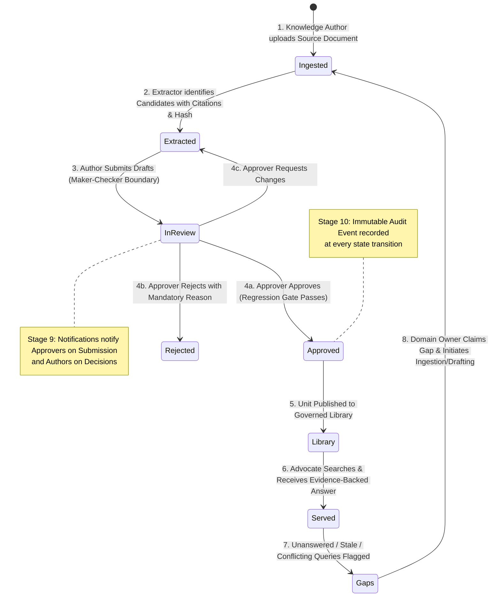
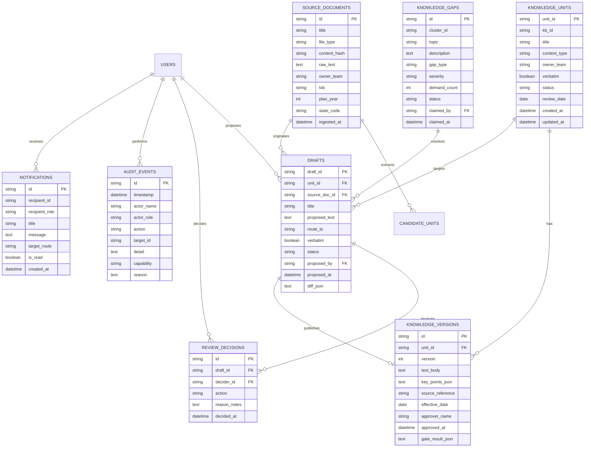
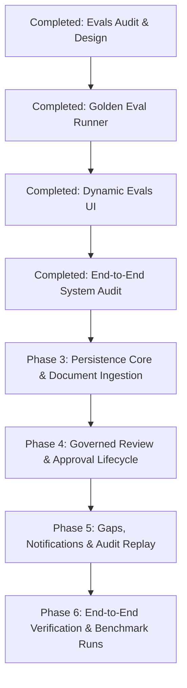

# Verity — End-to-End Governed Knowledge & Search Platform Audit

**Document version:** 1.0.0  
**Audit date:** October 11, 2026  
**Scope:** Complete repository inspection (`pixel-perfect-capture`), all routes, components, data models, workflows, RBAC policies, evaluation pipelines, and persistence architecture.  
**Author:** Antigravity AI Engineering Team  

---

## 1. Executive Summary & Product Objective

### 1.1 Product Mission
Verity is an **end-to-end governed enterprise knowledge and search platform**, purpose-built for regulated healthcare contact centers (e.g., Medicare Advantage, Part D pharmacy, commercial benefits). Verity is **not** merely an evaluations dashboard, a static wireframe prototype, or a generic vector search engine. 

Its fundamental value proposition is **governed accountability**:
- Every answer served to an advocate or member is strictly grounded in an approved, cited, effective knowledge unit.
- Content moves through a strict human governance lifecycle: Knowledge Authors extract and draft, Domain Owners approve standard policies, and Legal/Compliance approvers verify verbatim regulatory disclaimers.
- Unanswered, conflicting, or stale queries fail safely without hallucination and are automatically routed as actionable knowledge gaps to responsible owners.
- Access is partitioned by knowledge base and role, enforced deterministically before any model generation occurs.
- Every proposal, decision, access grant, and denial is immutably logged for compliance audit replay.

### 1.2 Current Architectural Reality
The codebase currently exhibits a **bifurcated architecture**:
1. **Rich UI / Design System:** Highly polished, production-grade React 19 UI with Tailwind CSS v4, Lucide icons, Radix UI primitives, responsive layouts, persona switching, and 143 passing unit/integration tests.
2. **Real Deterministic Serving & Evals Engine:** A functional 13-step governance engine (`src/verity-engine/`) executing deterministic retrieval, entitlement filtering, redaction, and a 27-case golden regression runner with live UI reporting (`/evals`).
3. **The Workflow & Persistence Gap:** The interactive screens for Ingestion (`/work`), Review Queue (`/review`), Knowledge Library (`/library`), Gaps (`/work?tab=gaps`), and Settings (`/access`) are currently **disconnected from real persistence and from each other**. 
   - State lives either in an in-memory client store (`src/services/demoStore.ts`), local React `useState` hooks, or an in-memory server singleton (`src/verity-engine/server.ts`).
   - Approving an item in the Review Queue does not update the Knowledge Library or the serving engine.
   - Ingesting a source document does not save raw document bytes or produce persisted candidate units.
   - Any server reload or page refresh wipes state.

---

## 2. Screen & Route Inventory (Step 1 Audit)

The repository defines 19 routes in `src/routes/` and 13 primary component feature groups in `src/components/`. Below is the verified audit of every existing route and component.

### 2.1 Route Audit Matrix

| Route Path | Component & Source File | Intended Roles / Personas | Functional Status | Data Storage Mode | E2E Working Actions vs. Placeholders |
| :--- | :--- | :--- | :--- | :--- | :--- |
| **`/welcome`** | `WelcomePage` [`src/routes/welcome.tsx`](file:///c:/Users/lakha/nitin_sir_collab/pixel-perfect-capture/src/routes/welcome.tsx) | Public / Unauthenticated visitors | **UI-Ready** | Hardcoded copy & SVG preview | **Working:** Navigation to `/sign-in`. **Placeholder:** "Request a demo" button does not submit lead info; acts as link to `/sign-in`. |
| **`/sign-in`** | `SignInPage` [`src/routes/sign-in.tsx`](file:///c:/Users/lakha/nitin_sir_collab/pixel-perfect-capture/src/routes/sign-in.tsx) | Public / All users | **Partially Functional** | Client-side form state | **Working:** Email syntax validation, navigation to `/onboarding`. **Placeholder:** Google / Microsoft OAuth buttons display demo notification; no SSO backend. |
| **`/onboarding`** | `OnboardingPage` [`src/routes/onboarding.tsx`](file:///c:/Users/lakha/nitin_sir_collab/pixel-perfect-capture/src/routes/onboarding.tsx) | All personas (Priya, Marcus, Sam, Eleanor, Dana, Owen, Rita, Alex, Casey, Nitin, Lee) | **Fully Functional** | Session state (`sessionStorage` via `src/lib/session.ts`) | **Working:** Role filtering, persona selection, capability/KB badge preview, session activation, dynamic redirect to role home route. |
| **`/`** | `AskPage`, `OutcomeCard`, `AnswerDetailsView`, `TraceDrawer`, `ChannelCompare` [`src/routes/index.tsx`](file:///c:/Users/lakha/nitin_sir_collab/pixel-perfect-capture/src/routes/index.tsx) | Advocates (`pharmacy_advocate`, `insurance_advocate`, `advocate_supervisor`), Members (`member_chat`) | **Connected to Server Logic** | In-memory client `demoStore.requests` + server `serveEngine` (if engine mode enabled) | **Working:** Submitting queries, 13-step trace inspection, citation preview, context switching (plan year, LOB, state), choice chips for clarification, browser speech recognition/synthesis, thumbs up/down, answer flagging (adds review task to in-memory store). **Placeholder:** No database persistence for query logs. |
| **`/library`** | `KnowledgeLibraryView`, `KnowledgeDetailPanel`, `ViewSourceModal`, `FlagReviewModal` [`src/routes/library.tsx`](file:///c:/Users/lakha/nitin_sir_collab/pixel-perfect-capture/src/routes/library.tsx) | Roles with `get_unit` (Authors, Owners, Approvers, Auditors, Supervisors) | **Mock-Backed + In-Memory** | In-memory `demoStore.units` enriched with `mockData.ts` metadata | **Working:** Scoped entitlement filtering per persona, search by keyword, filter by LOB/State/Status/Type, list/grid toggle, detail slide-over drawer with version history, flag modal, copy citations. **Placeholder:** "Add Knowledge" modal buttons route to `/work` but do not directly create live units. Not backed by a database. |
| **`/work`** | `WorkPage`, `IngestSourceWizard`, `ReviewExtractWorkspace` [`src/routes/work.tsx`](file:///c:/Users/lakha/nitin_sir_collab/pixel-perfect-capture/src/routes/work.tsx) | Knowledge Authors (`knowledge_author`), Knowledge Owners (`knowledge_owner`) | **Partially Functional** | Local React state + in-memory `demoStore.chainDrafts` | **Working:** 4-step wizard stepper, pasting markdown/text, basic double-newline extraction into candidates, editing candidate fields (title, type, content, effective date), selecting candidates, clicking "Propose Selected" appends to `demoStore.chainDrafts`. **Placeholder:** Binary file upload (PDF/DOCX) drops bytes and loads sample text; document preview is static mock HTML; extraction ignores complex document structures; proposals do NOT reach a persistent queue. |
| **`/review`** | `ReviewQueueView` [`src/routes/review.tsx`](file:///c:/Users/lakha/nitin_sir_collab/pixel-perfect-capture/src/routes/review.tsx) | Knowledge Owners (`knowledge_owner`), Legal Approvers (`legal_approver`) | **UI-Only / Disconnected** | Local React `useState(INITIAL_REVIEW_QUEUE)` | **Working:** Table sorting, tab switching (Pending, My Reviews, Requested Changes, Approved, Rejected), multi-select checkboxes, detail panel tabs (Content, Context, Source, History), reason modal for reject. **Disconnect / Placeholder:** **Does NOT read `demoStore.chainDrafts` or server `authoringState().queue`**. Approving/rejecting only updates local React state; **does NOT call `decideDraft` or publish units to `/library`**. |
| **`/work?tab=gaps`** | `KnowledgeGapsView` [`src/components/gaps/KnowledgeGapsView.tsx`](file:///c:/Users/lakha/nitin_sir_collab/pixel-perfect-capture/src/components/gaps/KnowledgeGapsView.tsx) | Knowledge Authors, Knowledge Owners | **Partially Functional** | Local React state + dynamic overlay from `demoStore.requests` | **Working:** Displays seeded gaps + live session unanswered queries (`insufficient_evidence`, `conflict`), severity filter, search filter, detail tab with frequency and activity log. **Placeholder:** "Create Unit from Gap" navigates to Ingest but does not pre-populate drafting state; claim action updates local state only. |
| **`/author`** | `GuardedAuthorPage` [`src/routes/author.tsx`](file:///c:/Users/lakha/nitin_sir_collab/pixel-perfect-capture/src/routes/author.tsx) | Knowledge Authors, Owners, Legal Approver, Access Admin | **Connected to Server Logic (Legacy Tabbed UI)** | In-memory server-side `KnowledgeStore` singleton | **Working:** Connects to TanStack Start server functions (`getAuthoring`, `ingestSourceFn`, `proposeFn`, `decideFn`, `proposeGapFn`, `claimGapFn`, `accessFn`). Runs real regression gate previews on pending drafts. **Status:** Superseded by modern wireframe pages (`/work`, `/review`, `/access`), but retains the real engine server-function bindings that the new wireframe pages lack. |
| **`/legal`** | `LegalPage` [`src/routes/legal.tsx`](file:///c:/Users/lakha/nitin_sir_collab/pixel-perfect-capture/src/routes/legal.tsx) | Legal Approver (`legal_approver`) | **Connected to Client In-Memory Store** | Reads/writes `demoStore.chainDrafts` and `demoStore.units` | **Working:** Verbatim vault inspection, side-by-side diff comparison, publication gate status check, inline wording editing, decision recording via `decideChainDraft()`. When approved here, draft updates `demoStore.units` with a new version number. |
| **`/health`** | `AnalyticsView` [`src/routes/health.tsx`](file:///c:/Users/lakha/nitin_sir_collab/pixel-perfect-capture/src/routes/health.tsx) | AI Product Owner, Leadership, Compliance Auditor, Supervisors | **Mock-Backed + Session Overlay** | Baseline mock telemetry + dynamic count of `demoStore.requests` | **Working:** LOB dropdown, date filter, topic breakdown, escalation table, export toast notification. **Placeholder:** Telemetry charts (Recharts) render static data arrays; no persistent time-series analytics storage. |
| **`/agents`** | `AgentsToolsView` [`src/routes/agents.tsx`](file:///c:/Users/lakha/nitin_sir_collab/pixel-perfect-capture/src/routes/agents.tsx) | AI Product Owner (`ai_product_owner`), Access Admin | **Partially Functional** | Hardcoded agent list + server-side in-memory `callLog` | **Working:** Agent tool configuration drawer, live tool execution testing via server function `callToolFn` -> `src/verity-engine/agents.ts`, call log viewer. **Placeholder:** Agent registration/editing does not persist across restarts; external agent connections are simulated. |
| **`/access`** | `SettingsView` [`src/routes/access.tsx`](file:///c:/Users/lakha/nitin_sir_collab/pixel-perfect-capture/src/routes/access.tsx) | Access Admin (`access_admin`), AI Product Owner | **Partially Functional** | Reads/writes in-memory `demoStore.access` | **Working:** General preferences tab, system toggles (voice, related questions, feedback), Users & Permissions matrix with role KB entitlements, grant/revoke modal with mandatory reason requirement, audit entry creation. **Placeholder:** Settings and access grants reset on browser refresh; no persisted policy storage. |
| **`/audit`** | `AuditPage` [`src/routes/audit.tsx`](file:///c:/Users/lakha/nitin_sir_collab/pixel-perfect-capture/src/routes/audit.tsx) | Compliance Auditor (`compliance_auditor`), Access Admin | **Connected to In-Memory Store** | `demoStore.audit` + `demoStore.requests` | **Working:** Event log table with filtering by actor, action, target, date; highlighted permission denial rows; Answer Replay by request ID reconstructing original trace; As-Of date query showing version active on a given date. **Placeholder:** Prototype in-memory storage; not write-once or tamper-evident. |
| **`/rights`** | `RightsPage` [`src/routes/rights.tsx`](file:///c:/Users/lakha/nitin_sir_collab/pixel-perfect-capture/src/routes/rights.tsx) | Public / All personas | **Fully Functional** | Dynamic rendering from `src/data/personas.json` | **Working:** Complete persona-by-capability matrix, separation-of-duties rules enforcement visualization, slide-out persona capability details drawer. |
| **`/platform`** | `PlatformPage` [`src/routes/platform.tsx`](file:///c:/Users/lakha/nitin_sir_collab/pixel-perfect-capture/src/routes/platform.tsx) | Public / Governance | **Fully Functional** | SVG vector visualizations | **Working:** Interactive consumer topology map, 13-step runtime architecture diagram (deterministic vs. probabilistic steps), built vs. roadmap feature matrix. |
| **`/story`** | `StoryPage` [`src/routes/story.tsx`](file:///c:/Users/lakha/nitin_sir_collab/pixel-perfect-capture/src/routes/story.tsx) | Public / Guided Demo | **Fully Functional** | Synthetic demonstration fixtures | **Working:** Illustrative "same question, three contradictory channel answers" problem demonstration, trigger to interactive guide rail walkthrough. |
| **`/evals`** | `EvalsPage` [`src/routes/evals.tsx`](file:///c:/Users/lakha/nitin_sir_collab/pixel-perfect-capture/src/routes/evals.tsx) | AI Product Owner (`ai_product_owner`), Compliance Auditor | **Connected to Real Server Logic** | Real server execution via `evalRunner.ts` against `golden_set.json` | **Working:** "Run Evaluation" button triggers server function `runEvaluationSuite`, executes all 27 golden cases against deterministic `pipeline.ts`, renders calculated aggregate metrics (accuracy, critical failures, zero leaks, 100% verbatim), filterable failure cases, detailed case inspector with trace and citations. |
| **Header Notifications** | `NotificationPopover` [`src/components/shell/NotificationPopover.tsx`](file:///c:/Users/lakha/nitin_sir_collab/pixel-perfect-capture/src/components/shell/NotificationPopover.tsx) | All personas | **Mock-Backed + In-Memory** | Static notification items + latest 2 rows from `demoStore.audit` | **Working:** Displays unread badge count, dropdown list with timestamps and icons, links directly to `/review`, `/work?tab=gaps`, and `/audit`. **Placeholder:** No read/unread state tracking; no real-time notification dispatch on workflow transitions. |

---

## 3. The 10-Stage End-to-End Governed Workflow (Step 2)

Verity's core purpose is an unbroken chain of custody for enterprise knowledge. Below is the specification of the 10 lifecycle stages, defining required state transitions, role authorizations, notifications, and persistence requirements.

### Stage 1 — Source Document Ingestion
- **Actor:** Knowledge Author (`knowledge_author`).
- **Action:** Uploads source file (PDF, DOCX, Markdown, plain text) with metadata: Document Title, Line of Business (`MAPD`, `Commercial`, `Medicaid`), Plan Year (`2026`, `2027`), Jurisdiction/State, Owning Team, and Effective Window.
- **System Action:** Generates a deterministic content hash (`SHA-256`), stores the raw document bytes and parsed text, checks for duplicate source documents, and initializes an ingestion job record.
- **Required State Transition:** Source Document created with status `INGESTED`.
- **RBAC Policy:** Requires `ingest_source` capability. Access Admins, Advocates, and Members are strictly denied.

### Stage 2 — Candidate Extraction & Evidence Linking
- **Actor:** Automated Extraction Engine (guided by Knowledge Author).
- **Action:** Analyzes source text against existing knowledge units:
  1. Identifies discrete units of knowledge (policies, procedures, copays, verbatim legal disclaimers).
  2. Binds exact source section references and byte offsets.
  3. Computes similarity to existing units to detect:
     - `UNCHANGED`: Existing unit matches source text exactly.
     - `CHANGED_FLAGGED`: Existing unit text drifted or altered.
     - `NEW`: Novel policy statement not currently represented in the library.
  4. Tags suggested routing: `owner` (domain owner) vs. `legal` (verbatim regulatory text).
- **Required State Transition:** Ingestion job produces candidate records with status `EXTRACTED`.
- **Persistence:** Candidates stored with source references, diffs, and confidence metrics.

### Stage 3 — Submission for Review (Maker-Checker Boundary)
- **Actor:** Knowledge Author (`knowledge_author`).
- **Action:** Reviews extracted candidates, edits proposed wording if necessary, selects valid units, and submits them to the governance review queue.
- **Maker-Checker Enforcement:** The system records `proposed_by = author.id`. The author is cryptographically and logically prohibited from approving their own proposal (`proposer !== approver`).
- **Required State Transition:** Candidate transitioned to Draft with status `PENDING_REVIEW`.
- **Notification:** Dispatches high-priority notification to Domain Owners or Legal Approvers in scope.
- **Audit Event:** Emits `DRAFT_PROPOSED` audit log with draft ID, unit ID, and author ID.

### Stage 4 — Reviewer Inspection & Human Approval
- **Actor:** Knowledge Owner (`knowledge_owner`) for standard operational units; Legal/Compliance Approver (`legal_approver`) for verbatim regulatory disclaimers.
- **Action:** Reviewer inspects side-by-side wording diff, source citations, and golden regression gate results.
- **Permitted Decisions:**
  1. **Approve:** Executes golden regression gate. If zero critical failures occur, increments unit version number, records approver identity and effective date, and marks draft `APPROVED`.
  2. **Reject:** Mandatory text reason required. Marks draft `REJECTED`, preserves history, and archives draft without altering live library.
  3. **Request Changes:** Appends reviewer notes and returns draft to author queue with status `CHANGES_REQUESTED`.
- **Required State Transitions:**
  - `PENDING_REVIEW` → `APPROVED` (creates new `KnowledgeVersion` record).
  - `PENDING_REVIEW` → `REJECTED` (terminal draft state).
  - `PENDING_REVIEW` → `CHANGES_REQUESTED` (returns to author).
- **Audit Event:** Emits `DRAFT_APPROVED`, `DRAFT_REJECTED`, or `CHANGES_REQUESTED` with actor name, role, timestamp, and notes.

### Stage 5 — Publication to Governed Knowledge Library
- **System Action:** Once approved, the new version becomes live in the Knowledge Library:
  - If a prior version existed, it is archived into version history.
  - The unit's `effective_date`, `next_review_date`, and `status = 'approved'` are updated.
  - The unit is immediately available to the deterministic search pipeline for subsequent queries.
- **Notification:** Author notified that their proposed draft has been approved and published.

### Stage 6 — Permission-Aware Advocate & Member Search
- **Actor:** Pharmacy Advocate, Insurance Advocate, Advocate Supervisor, Member Chat, or Downstream AI Agent.
- **Pipeline Execution:** 13-step deterministic runtime:
  1. Bind requesting persona and entitlement scope (e.g., `Priya` → `KB-PHARM`, `KB-SHARED`).
  2. Redact PHI from search query.
  3. Retrieve candidate units matching query and metadata (LOB, Plan Year, State).
  4. **Entitlement Filter (Step 7):** Hard stop before generation. Discards any candidate unit belonging to a knowledge base the user's role is not authorized to read.
  5. **Freshness & Conflict Check (Step 9):** Checks effective window. If expired, marks `stale`. If two conflicting units match, marks `conflict`.
  6. Return approved text with mandatory provenance: Unit ID, Version Number, Approver Name, Effective Date, and Citation Section.

### Stage 7 — Safe Handling of Unanswered Queries
- **Behavior:** Verity never guesses or hallucinates. When approved knowledge cannot answer:
  - `insufficient_evidence`: No unit covers the topic.
  - `not_authorized`: User's role cannot read the owning KB (returns warm-transfer instructions without leaking internal content).
  - `conflict`: Two approved units contradict each other (neither is served as current).
  - `stale`: Effective review date has expired.
  - `safety_escalation`: Medical emergency or adverse event detected.
- **System Action:** Logs the query, redacting PHI, with full trace diagnostics and recorded outcome.

### Stage 8 — Knowledge Gap Routing to Domain Owners
- **System Action:** Unanswered queries (`insufficient_evidence`, `conflict`, `stale`) automatically cluster into actionable Knowledge Gaps.
- **Actor:** Knowledge Owner (`knowledge_owner`).
- **Action:**
  1. Inspects demand frequency, age, and impacted LOB.
  2. **Claims Gap:** Claims ownership so multiple authors do not duplicate work.
  3. **Initiates Authoring:** Automatically converts the gap cluster into an authoring task or ingestion job, linking back to the originating queries.
- **State Transition:** Gap status moves `OPEN` → `CLAIMED` → `IN_PROGRESS` → `RESOLVED` (when the resolving unit is published).

### Stage 9 — Event-Driven Notifications
- **System Action:** Subscriptions notify stakeholders across boundaries:
  - Ingestion complete → Author notified.
  - Submission for review → Assigned Approvers notified with direct review link.
  - Decision made (Approved / Rejected / Changes Requested) → Submitting Author notified.
  - Answer flagged on Ask screen → Owning Knowledge Owner notified.
  - Escalated query or conflict detected → Supervisor and Knowledge Owner notified.
  - Gap resolved → Inquiring advocates or supervisors notified.
- **Persistence:** Notifications stored with recipient ID/role, read/unread status, target URL, and timestamp.

### Stage 10 — Comprehensive Audit History & Compliance Replay
- **System Action:** Append-only audit logging:
  - Actor identity, persona, and role.
  - Action name (`ingest`, `propose`, `approve`, `reject`, `reverify`, `grant_access`, `revoke_access`, `denied`, `search`).
  - Target entity ID and version.
  - Exact diff, justification, or reason.
- **Compliance Replay:** Compliance Auditor can input any historical `request_id` or date to reconstruct exactly what answer was served, which unit version was active on that date, and which rule governed the decision.

---

## 4. Shared Data Architecture & Persistence Strategy (Step 3)

### 4.1 Architecture Analysis of the Current Stack
The application is structured as follows:
- **Framework:** TanStack Start (`@tanstack/react-start: 1.168.60`) with TanStack Router (`1.170.41`).
- **Build / SSR System:** Vite with `@lovable.dev/vite-tanstack-config`, deploying via Nitro.
- **Nitro Deployment Target:** Configured for `cloudflare-module` (Cloudflare Pages / Workers), while running locally in Node.js (Vite SSR).
- **Current State Management:**
  - Client: `src/services/demoStore.ts` (React `useSyncExternalStore` module state).
  - Server: `src/verity-engine/server.ts` (`let store: KnowledgeStore | null = null`).
  - Screen Local: Components like `ReviewQueueView` use independent `useState`.

### 4.2 Identified In-Memory Storage Flaws
1. **Zero Database Durability:** Refreshing the browser or restarting the Nitro/Node server wipes all newly created drafts, uploaded sources, review actions, and gap claims.
2. **Dual-Store Divergence:** 
   - When a user proposes drafts in `/work`, they are appended to client `demoStore.chainDrafts`.
   - But `src/verity-engine/authoring.ts` operates on the server-side `KnowledgeStore`.
   - And `ReviewQueueView.tsx` reads neither, operating on its own local `INITIAL_REVIEW_QUEUE` array.
3. **No Multi-User Concurrency:** Changes made by one persona are not visible to another persona in separate browser tabs or sessions.

### 4.3 Recommended Persistent Storage Engine: Cloudflare D1 / SQLite via Kysely

To achieve true persistence without introducing unnecessary infrastructure complexity or breaking Cloudflare deployment compatibility:

#### **Recommendation: SQLite (Cloudflare D1 in production, Better-SQLite3 / LibSQL in development and testing) managed via Kysely.**

**Why this is the optimal choice:**
1. **Native Cloudflare Deployment Compatibility:**
   - The production deployment target is Nitro on Cloudflare. Cloudflare D1 is Cloudflare's native serverless SQL database, running SQLite at the edge.
   - It requires zero external networking, has sub-10ms query latency, zero cold-start delay, and is built directly into Nitro / Workers via `env.DB`.
2. **100% Identical SQL in Local Development:**
   - In Node.js / Vite development and Vitest environments, `better-sqlite3` runs the exact same SQLite dialect with identical schemas, transactions, and performance.
   - Tests execute locally in milliseconds without spinning up external Docker containers.
3. **Type-Safe Query Layer (Kysely):**
   - Kysely is a lightweight, zero-dependency, type-safe SQL query builder designed specifically for TypeScript.
   - It supports pluggable dialect drivers: `D1Dialect` for Cloudflare Workers and `SqliteDialect` (via `better-sqlite3`) for Node.js / Vitest.
   - Eliminates heavyweight ORM runtime overhead and code generation fragility while providing full compile-time type safety across all queries.

### 4.4 Target Relational Database Schema

---

## 5. Preservation of Existing Work (Step 4)

In accordance with strict project instructions:
1. **Preserve All Visual Designs & Wireframes:**
   - Do **not** redesign the UI screens, color systems, typography, or component structures.
   - Preserve existing layouts: `IngestSourceWizard.tsx`, `ReviewExtractWorkspace.tsx`, `ReviewQueueView.tsx`, `KnowledgeLibraryView.tsx`, `KnowledgeGapsView.tsx`, `AnalyticsView.tsx`, `AgentsToolsView.tsx`, and `SettingsView.tsx`.
2. **Preserve Completed Evals Implementation:**
   - The Golden Evaluation Runner (`src/verity-engine/evalRunner.ts`), server functions (`src/services/evals.functions.ts`), and dynamic UI (`src/routes/evals.tsx`) implemented in Phases 1 & 2 are working, verified, and test-covered (143 passing tests). They will be preserved completely.
3. **Preserve the Deterministic Serving Engine:**
   - The 13-step governance pipeline in `src/verity-engine/pipeline.ts`, retrieval heuristics in `retrieval.ts`, and RBAC enforcement logic in `src/data/personas.json` and `src/lib/rights.ts` are foundational and must remain unchanged.

---

## 6. Phased Implementation Roadmap

To avoid unstable mega-refactors, implementation will proceed through clearly bounded phases with strict dependencies and acceptance criteria:

### Phase 3 — Unified Relational Persistence & Document Ingestion Core
**Objective:** Establish the persistent database layer (SQLite / D1) and connect the Ingestion flow (`/work`) to real server-side document storage and parsing.
- **Deliverables:**
  1. Database initialization and migration runner for SQLite/D1 via Kysely.
  2. Data access repositories for `source_documents`, `knowledge_units`, `knowledge_versions`, and `drafts`.
  3. Server function `uploadAndIngestSource` that accepts real document text and metadata, computes SHA-256 hashes, stores source records, and executes candidate extraction.
  4. Connect `IngestSourceWizard.tsx` and `ReviewExtractWorkspace.tsx` to the server function, replacing mock text substitution with persisted candidate units.
- **Acceptance Criteria:**
  - Uploading a document saves a row in `source_documents`.
  - Extracted candidates persist with real source references and diffs.
  - Page refresh preserves uploaded documents and candidate extraction history.

### Phase 4 — Governed Review & Approval Lifecycle (Maker-Checker)
**Objective:** Connect the Review Queue (`/review`) and Legal Approval (`/legal`) to the persisted drafts repository with strict maker-checker enforcement.
- **Deliverables:**
  1. Connect `ReviewQueueView.tsx` to load live pending drafts from the database rather than `INITIAL_REVIEW_QUEUE`.
  2. Implement server functions `decideDraftAction` supporting `approve`, `reject`, and `request_changes`.
  3. Wire the publication gate: On approval, run regression preview. If clean, create a new `KnowledgeVersion` row, update the unit status to `approved`, and record the decider.
  4. Ensure approved units immediately become searchable on `/` (Ask) and viewable on `/library` (Knowledge Library).
- **Acceptance Criteria:**
  - Author proposing a draft cannot approve it (maker-checker rule strictly blocks decision).
  - Approving a draft in `ReviewQueueView` or `LegalPage` instantly publishes it to the Knowledge Library and Ask page.
  - Rejecting requires a mandatory reason and records an audit event.

### Phase 5 — Knowledge Gaps, Notifications & Audit Replay
**Objective:** Connect unanswered queries to the Knowledge Gaps backlog, establish real notification triggers, and enable tamper-evident audit logging.
- **Deliverables:**
  1. Automated gap logging: When `serveEngine` returns `insufficient_evidence` or `conflict`, automatically upsert an entry in `knowledge_gaps`.
  2. Connect `KnowledgeGapsView.tsx` to claim gaps and initiate draft generation directly from the gap card.
  3. Real notification service: Submissions, review assignments, and approval decisions create persisted `notifications` rows rendered dynamically in `NotificationPopover.tsx`.
  4. Wire `AuditPage.tsx` to query persisted `audit_events`, supporting full answer replay by `request_id` and as-of version reconstruction.
- **Acceptance Criteria:**
  - Asking an unanswered query on Ask page creates a visible gap in Knowledge Gaps.
  - Claiming a gap updates ownership in the database.
  - Review queue updates generate live notification items in the header.
  - Audit log table persists across server restarts.

### Phase 6 — End-to-End System Verification & Release Gate
**Objective:** Verify the entire platform end to end across all 5 roles and run full regression suites.
- **Deliverables:**
  1. Automated E2E integration tests simulating:
     - Knowledge Author uploads document → extracts candidates → submits draft.
     - Reviewer inspects diff → approves draft.
     - Knowledge Library displays updated version.
     - Pharmacy Advocate searches for new policy → receives approved cited answer.
     - Auditor inspects audit trail and replays request.
  2. Execute golden evaluation run on `/evals` to confirm zero regression on the 27 benchmark cases.
- **Acceptance Criteria:**
  - 100% of the 10-stage lifecycle functions without manual intervention or mock data fallback.
  - All unit, integration, and evaluation suites pass cleanly.

---

## 7. Immediate Recommendation & Next Steps

1. **Audit Completion:** This comprehensive audit (`docs/VERITY_END_TO_END_AUDIT.md`) establishes the complete factual baseline across all 19 routes and components.
2. **Current Branch Status:** Working directory is intact, git status is clean of commits/pushes/branch changes, and all 143 existing tests pass cleanly.
3. **Recommended Next Phase:** Await review and approval of this audit report. Upon approval, proceed directly to **Phase 3: Unified Relational Persistence & Document Ingestion Core**.
